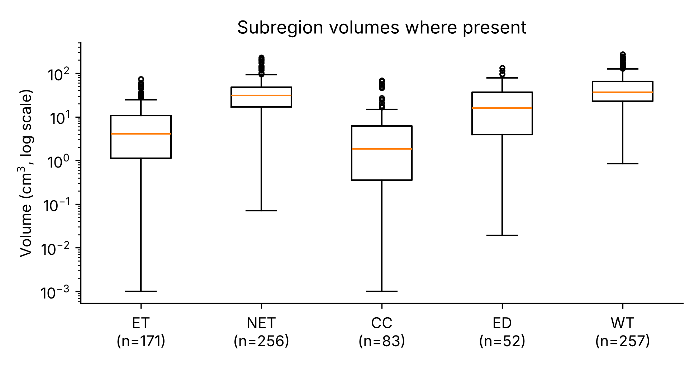

# Automated 3D Segmentation of Paediatric High-Grade Gliomas from Multiparametric MRI: Project Definition and Literature Review

Itzel Priscilla Aguilar-Valdez, Steven Gill, Iles Ousmer, Ansar Tlemussov

EXSU 500, Group 19 · Department of Surgery, McGill University, Montreal, Canada

Repository: https://github.com/iles-mcgill/EXSU500-Paediatric-HGGs-AI

Abstract—We define a 3D segmentation task for paediatric high-grade glioma (pHGG) on pre-treatment multiparametric MRI using the public BraTS-PEDs collection. Of 457 patients, 257 have expert masks; we split them at patient level into training, internal validation and internal test sets. Whole tumour is the primary target and the four tumour subregions are secondary. We will compare a FLAIR intensity threshold, a voxel-wise random forest and a 3D U-Net using Dice and the 95th percentile Hausdorff distance. This report reviews prior work, describes the data quantitatively and sets out the evaluation protocol, work plan and risks.

## I. Introduction

Paediatric high-grade gliomas (pHGG) carry a poor prognosis, with five-year survival below 20% [4].

These tumours are diffuse and infiltrative. Many are diffuse midline gliomas (DMG), including diffuse intrinsic pontine gliomas (DIPG), for which surgical resection is generally not feasible; management relies on radiotherapy [12] and imaging follow-up [10]. For selected non-pontine pHGG, resection remains an option, but tumour margins are difficult to define and injury to functional brain tissue can cause severe neurological deficits.

Accurate delineation of the tumour and its subregions on MRI therefore underpins treatment planning, radiotherapy target definition and response assessment. Manual 3D segmentation, however, requires expert time and is subject to inter-observer variability [3], [9]. Automated segmentation could make volumetric delineation faster and more reproducible. Our question is specific and answerable with public data: how accurately can models of increasing complexity segment the whole tumour on pre-treatment MRI of pHGG, compared with expert reference masks? The project evaluates segmentation accuracy only; it does not test any clinical use.

## II. Related Work

Search strategy. Literature was identified through a structured PubMed search combining MeSH and title/abstract terms for five concepts (brain tumour, paediatric population, MRI, artificial intelligence and segmentation; search date [2026-11-08]), a complementary keyword search, and citation-network exploration with Connected Papers seeded with a recent BraTS-PEDs segmentation study [5], prioritising primary studies published from 2021 onward. Foundational benchmark and methods papers were added where needed.

Adult glioma segmentation. Since 2012, the BraTS challenges have provided the reference benchmark for brain tumour segmentation, with multi-institutional multiparametric MRI, expert subregion annotations and a common evaluation of enhancing tumour, tumour core and whole tumour [6], [7]. Among deep learning approaches, nnU-Net, a framework that automatically configures its own preprocessing, architecture and training, outperformed most specialised solutions across 23 public segmentation datasets without manual tuning [8], and it underlies most of the paediatric methods reviewed below [4], [9], [10], [11].

Paediatric tumours. Paediatric brain tumours differ from adult tumours in prevalence, imaging appearance and histology [9], and many paediatric high-grade gliomas arise in midline structures such as the brainstem and thalamus [12]. When top methods developed for adult glioma were applied to unseen paediatric scans in BraTS 2022, the results showed that paediatric segmentation requires training on paediatric data [4]. This motivated BraTS-PEDs, the first large-scale open benchmark dedicated to paediatric brain tumour segmentation, with 457 patients from multiple institutions [1], [2]. In the 2023 challenge, all top-ranked methods were U-Net-based (ensembles of nnU-Net and Swin UNETR, Auto3DSeg, and self-supervised nnU-Net) and reached mean WT Dice of 0.83–0.84; the organisers noted that most methods locate the whole tumour reliably, but distinguishing tumour compartments remains a significant challenge [4]. Independent studies report similar whole-tumour performance: nnU-Net outperformed DeepMedic on 339 paediatric patients (WT Dice 0.90 vs. 0.82) and reached 0.87 on BraTS-PEDs 2023 [9]; DeepMedic achieved 0.91 internally and 0.88 externally in an earlier multi-institutional study [13]; and an ensemble of multi-encoder attention models reached 0.876 on BraTS-PEDs 2024 [5]. Studies dedicated to diffuse midline glioma report WT Dice of 0.88 with a residual 3D U-Net [14] and 0.87 on an external test set with a GAN-based model [12], and an nnU-Net-based model trained with post-treatment scans outperformed the BraTS-PEDs 2024 winning model on clinical trial data (0.90 vs. 0.81) [10]. These DMG studies, however, rely on small cohorts of 52 to 142 patients [12], [14], and because paediatric data are scarce, several groups pretrain on adult glioma data before fine-tuning on children [11], [12], [15]. Subregion performance is consistently lower than whole-tumour performance: nnU-Net Dice fell from 0.90 for WT to 0.66 for NET [9], and in paediatric medulloblastoma Dice for the combined cystic and non-enhancing components was 0.29–0.48 [11]. Similar nnU-Net pipelines have been applied to other paediatric tumours, such as posterior fossa ependymoma [16].

Classical approaches. Before deep learning became standard, voxel-wise classifiers trained on hand-crafted intensity and texture features were used for brain tumour segmentation; for example, a random forest using texton and network-derived features reached a WT Dice of 0.86 on BraTS 2017 validation data [17]. Intensity thresholds require no training and therefore provide a transparent lower bound for learned models. Among the paediatric studies reviewed here, comparisons are almost exclusively between deep learning architectures; only one reports a non-deep-learning (atlas-based) reference [18], so the gain of deep learning over simpler methods on paediatric data is rarely quantified.

Evaluation practice. The Dice similarity coefficient and the 95th-percentile Hausdorff distance are the standard metrics in BraTS [6] and in the paediatric studies above [4], [9], [12]. Metric choice matters: chosen metrics often fail to reflect the clinical interest, and the Metrics Reloaded consortium recommends selecting them from a structured description of the problem, including the properties of the target structures [19]. Reporting also varies, from mean ± SD [9] to median and IQR [10], and the BraTS-PEDs challenge used lesion-wise scoring [4], so results from different studies are not always directly comparable.

Gap addressed. Prior work establishes U-Net-based models as the state of the art for whole-tumour segmentation of paediatric gliomas, but leaves three gaps that this project addresses on the public BraTS-PEDs cohort: (i) we compare a threshold baseline, a classical random forest and a 3D U-Net under a single, pre-declared, patient-level protocol, quantifying what each increase in complexity adds; (ii) we report subregion results alongside whole-tumour results, with the number of patients in whom each subregion is present; and (iii) we report uncertainty with bootstrap confidence intervals.

## III. Dataset

We use BraTS-PEDs (Version 1, The Cancer Imaging Archive, CC BY 4.0) [1], a multi-institutional collection of 457 treatment-naive pHGG, mostly DMG [2]. Of the 348 publicly downloadable patients, only the 257 in the official training cohort have expert segmentations. These form our labelled cohort and come from three sources: the Children's Brain Tumor Network (CBTN, n = 116), the Dana-Farber/Boston Children's collection (DFCI, n = 61) and the International DIPG/DMG Registry (DIPGr, n = 80).

Each patient has one baseline examination with T1, contrast-enhanced T1, T2 and T2-FLAIR images, co-registered, defaced and resampled to 1 mm isotropic voxels (240 × 240 × 155). The masks label enhancing tumour (ET), non-enhancing tumour (NET), cystic component (CC) and peritumoral edema (ED); automatic initial labels were refined and reviewed by neuroradiologists [1]. Whole tumour (WT, the union of ET, NET, CC and ED) was present in every patient (median 37.0 cm³, IQR 22.7–64.4), whereas NET was present in 99.6% of patients, ET in 66.5%, CC in 32.3% and ED in only 20.2% (Fig. 1). Some annotated regions are very small (ET or CC < 0.1 cm³ in 9 patients each). We therefore use WT as the primary target and the subregions as secondary outcomes.

Age and sex are available only for the 116 CBTN patients (45.1%): median age 8.3 years (IQR 6.0–12.5; five patients older than 18), 64 female and 52 male. Scanner metadata, also limited to CBTN, show several vendors and both 1.5 T and 3 T acquisitions. Known limitations are a small, mostly U.S. cohort, incomplete demographics, heterogeneous scanners and protocols, rare subregions and inter-observer variability in the reference masks.

Fig. 1. Subregion and whole-tumour volumes in the 257 labelled patients, shown only where the region is present (log scale).

## IV. Evaluation Protocol

We split the 257 patients at patient level into training (179), internal validation (39) and internal test (39) sets with a fixed random seed (42), stratified by source (Table I). Each patient has a single examination, so no patient contributes images to more than one set. All tuning uses the internal validation set; the internal test set is evaluated once, after the models are fixed. These internal sets are separate from the official TCIA validation and test groups, which have no public masks.

Table I. Labelled Cohort by Source and Split

| Source | Train | Int. val | Int. test | Total |
| --- | --- | --- | --- | --- |
| CBTN | 80 | 18 | 18 | 116 |
| DFCI | 43 | 9 | 9 | 61 |
| DIPGr | 56 | 12 | 12 | 80 |
| Total | 179 | 39 | 39 | 257 |

The primary metrics are the Dice similarity coefficient and the 95th percentile Hausdorff distance (HD95) for WT; the same metrics are reported for each subregion as secondary outcomes. Metrics are computed per patient over the whole region. For empty masks we follow the BraTS convention: if both reference and prediction are empty, Dice = 1 and HD95 = 0; if only one is empty, Dice = 0. For HD95 in that case our protocol uses a penalty of 373.13 mm, the diagonal of our 240 × 240 × 155 mm volume; the BraTS-PEDs 2023 challenge used 374 mm and lesion-wise scoring [4], so our values are not directly comparable with the challenge leaderboard. For each metric we will report the mean and median with 95% bootstrap confidence intervals over patients (1,000 resamples), and the number of patients in whom each subregion is present. The random forest is additionally trained with three random seeds, and the 3D U-Net will be if compute allows. As the interpretability artefact, we will produce error maps overlaying false-positive and false-negative voxels on T2-FLAIR for the best, median and worst test cases, with an error analysis of WT Dice by tumour volume and data source; we will also report random forest feature importances and show voxel-wise probability maps for the 3D U-Net.

## V. Candidate Models

Baseline: T2-FLAIR intensities are z-scored within the head, a single threshold is tuned on the training set, and the largest connected component is kept as the WT prediction.

Classical machine learning: a voxel-wise random forest (50 trees, maximum depth 12) on nine features: the z-scored intensity of each sequence, its 5 × 5 × 5 neighbourhood mean, and the distance from the head boundary. Training voxels are sampled from a subset of training patients to fit memory limits.

Deep learning: a 3D U-Net (MONAI) trained on image patches from all four sequences, with mixed precision to fit a single cloud GPU. [Modelling leads: patch size, loss, epochs, augmentation.]

In preliminary runs on the internal validation set, mean WT Dice was 0.23 for the threshold baseline and 0.36 for the random forest, with near-zero Dice for the rare subregions; these figures are not final results. [Confirm with Steven:]

## VI. Work Plan and Risks

Each of the four areas required by the course has an accountable lead and a second contributor: data lead A. Tlemussov (with I. Ousmer), modelling lead I. Aguilar-Valdez (with S. Gill), interface lead S. Gill (with A. Tlemussov) and writing lead I. Ousmer (with I. Aguilar-Valdez). Every member contributes to code and manuscript through their own GitHub account. The cohort description and the patient-level split are complete and stored in the repository.

The released images are already co-registered and resampled to 1 mm, so after the midterm we will first check whether additional processing is needed (for example skull stripping, or the cases with documented exceptions), and then apply intensity normalisation and cropping according to an agreed protocol. The three models follow in order of complexity. The internal test set is evaluated once, planned for late November, and the last two weeks are reserved for the manuscript, model card, repository and recorded presentation, due on 11 December.

The main risk is compute for the 3D U-Net. No lab GPU is available to the team. The baseline and random forest need no GPU and already run on CPU in Google Colab. The 3D U-Net will be trained on a free cloud GPU (Google Colab or Kaggle) with session time limits; a short pilot run will confirm its memory use and training time before full training. Patch-based training, a smaller input size and mixed precision help fit these limits; a simpler or 2D model is a possible fallback (Table II).

Table II. Main Risks and Mitigations

| Risk | Mitigation |
| --- | --- |
| Insufficient GPU for 3D U-Net | Free cloud GPU; patches, smaller input, mixed precision; simpler or 2D fallback |
| Small cohort, rare CC/ED | WT as primary target; bootstrap confidence intervals |
| Very small or variable reference masks | Report counts; targeted visual review; predefined empty-mask rules |
| Data leakage or test-set reuse | Patient-level split fixed before training; test used once |
| Heterogeneous scanners, U.S.-based data | Stratified split; no claims of external generalisability |
| Member unavailability | Lead plus second contributor per area; shared repository |

## References

[1] A. Fathi Kazerooni et al., “The Brain Tumor Segmentation in Pediatric Magnetic Resonance Imaging (BraTS-PEDs) (Version 1),” The Cancer Imaging Archive, 2025, doi: 10.7937/DX5C-TJ86.

[2] A. Fathi Kazerooni et al., “Multi-institutional annotated multiparametric MRI dataset of pediatric high-grade gliomas,” Radiol. Artif. Intell., vol. 8, no. 3, Art. no. e250902, 2026, doi: 10.1148/ryai.250902.

[3] A. Odland et al., “Volumetric glioma quantification: comparison of manual and semi-automatic tumor segmentation for the quantification of tumor growth,” Acta Radiol., 2015, doi: 10.1177/0284185114554822.

[4] A. Fathi Kazerooni et al., “BraTS-PEDs: Results of the multi-consortium international pediatric brain tumor segmentation challenge 2023,” Mach. Learn. Biomed. Imaging, 2025.

[5] A. Cariola, E. Sibilano, A. Guerriero, V. Bevilacqua, and A. Brunetti, “Deep learning strategies for semantic segmentation of pediatric brain tumors in multiparametric MRI,” Sci. Rep., vol. 15, Art. no. 22595, 2025, doi: 10.1038/s41598-025-07257-2.

[6] U. Baid et al., “The RSNA-ASNR-MICCAI BraTS 2021 benchmark on brain tumor segmentation and radiogenomic classification,” arXiv:2107.02314, 2021.

[7] S. Bakas et al., “Identifying the best machine learning algorithms for brain tumor segmentation, progression assessment, and overall survival prediction in the BRATS challenge,” arXiv:1811.02629, 2018.

[8] F. Isensee, P. F. Jaeger, S. A. A. Kohl, J. Petersen, and K. H. Maier-Hein, “nnU-Net: a self-configuring method for deep learning-based biomedical image segmentation,” Nat. Methods, vol. 18, no. 2, pp. 203–211, 2021, doi: 10.1038/s41592-020-01008-z.

[9] A. Vossough et al., “Training and comparison of nnU-Net and DeepMedic methods for autosegmentation of pediatric brain tumors,” AJNR Am. J. Neuroradiol., vol. 45, no. 8, pp. 1081–1089, 2024, doi: 10.3174/ajnr.A8293.

[10] J. Zielke et al., “Improved deep learning segmentation of pediatric diffuse midline gliomas after treatment,” AJNR Am. J. Neuroradiol., 2026, doi: 10.3174/ajnr.A9609.

[11] R. Bareja et al., “nnU-Net–based segmentation of tumor subcompartments in pediatric medulloblastoma using multiparametric MRI: A multi-institutional study,” Radiol. Artif. Intell., vol. 6, no. 5, Art. no. e230115, 2024, doi: 10.1148/ryai.230115.

[12] Y. Deng, T. Chen, Y. Zhang, and B. Huang, “A deep learning-based automatic segmentation model for diffuse midline glioma with H3K27M alteration,” Front. Oncol., vol. 15, Art. no. 1602516, 2025, doi: 10.3389/fonc.2025.1602516.

[13] A. Fathi Kazerooni et al., “Automated tumor segmentation and brain tissue extraction from multiparametric MRI of pediatric brain tumors: A multi-institutional study,” Neuro-Oncol. Adv., vol. 5, no. 1, Art. no. vdad027, 2023, doi: 10.1093/noajnl/vdad027.

[14] M. Fernández-Patón et al., “Deep learning auto-segmentation of diffuse midline glioma on multimodal magnetic resonance images,” J. Imaging Inform. Med., vol. 39, pp. 411–421, 2026, doi: 10.1007/s10278-025-01557-9.

[15] A. Boyd et al., “Stepwise transfer learning for expert-level pediatric brain tumor MRI segmentation in a limited data scenario,” Radiol. Artif. Intell., vol. 6, no. 4, Art. no. e230254, 2024, doi: 10.1148/ryai.230254.

[16] D. Cheng et al., “A fully automated deep-learning model for predicting the molecular subtypes of posterior fossa ependymomas using T2-weighted images,” Clin. Cancer Res., vol. 30, no. 1, pp. 150–158, 2024, doi: 10.1158/1078-0432.CCR-23-1461.

[17] M. Soltaninejad, L. Zhang, T. Lambrou, G. Yang, N. Allinson, and X. Ye, “MRI brain tumor segmentation and patient survival prediction using random forests and fully convolutional networks,” in Brainlesion: Glioma, Multiple Sclerosis, Stroke and Traumatic Brain Injuries (BrainLes 2017), LNCS, vol. 10670. Cham: Springer, 2018, pp. 204–215.

[18] W. Wang, S. Chen, and M. Jiang, “Deep learning-based automated segmentation of brain and vertebral substructures for radiotherapy in pediatric medulloblastoma,” Chin. J. Med. Instrum., vol. 50, no. 1, pp. 15–23, 2026, doi: 10.12455/j.issn.1671-7104.250219.

[19] L. Maier-Hein et al., “Metrics reloaded: recommendations for image analysis validation,” Nat. Methods, vol. 21, no. 2, pp. 195–212, 2024, doi: 10.1038/s41592-023-02151-z.

## CRediT authorship contribution statement

I. Aguilar-Valdez: Investigation, Methodology, Software, Writing (original draft), Writing (review and editing).  
S. Gill: Methodology, Software, Formal Analysis, Visualization, Writing (original draft).  
I. Ousmer: Investigation, Conceptualization, Writing (original draft), Writing (review and editing).  
A. Tlemussov: Data Curation, Software, Formal Analysis, Visualization, Writing (original draft).

## Use of Generative AI

The authors identified literature through structured PubMed searches (MeSH and title/abstract terms) and Connected Papers. Claude Opus 5.5 (Anthropic) was used to search for additional candidate papers and compare them with these results. GitHub Copilot was used to suggest a repository commit message.

All cited references were retrieved and verified against the original publications, figures reported from them were checked by the authors, and all AI-drafted text was reviewed and revised by the authors. The authors take full responsibility for the content of this work.
